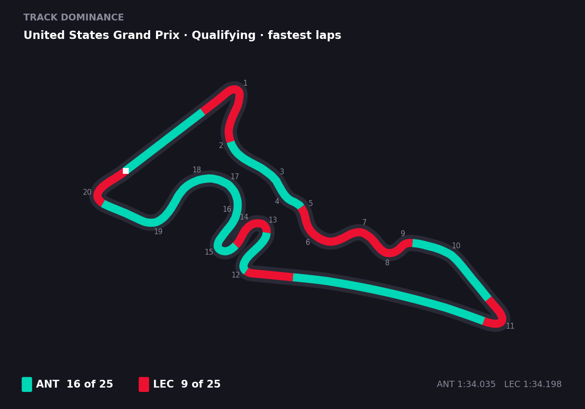

<h1> F1 Replay Timing</h1>


https://github.com/user-attachments/assets/5c62dcf8-3156-4079-96d1-bd24ce64ebda


> [!IMPORTANT]
> **From 15 October 2026, F1 requires an F1 TV subscription to access its timing data, which is now behind a paywall.** F1 Replay Timing has been updated (2.3.0) to download sessions with your own F1 TV account (Access or higher). Sessions you've already downloaded keep working, and so does live timing.
>
> **What you need to do after updating:**
> 1. Update dependencies: `pip install -r requirements.txt`, or rebuild the Docker image.
> 2. Set `F1TV_SECRET_KEY` in `.env`. Generate one with `openssl rand -hex 32`.
> 3. Sign in: click **F1 TV** on the home page and sign in with your F1 account. **Or** set `F1_USERNAME` and `F1_PASSWORD` in `.env` instead.
>
> Full details in [F1 TV account](#f1-tv-account).

A web app for watching Formula 1 sessions with real timing data, car positions on track, driver telemetry, and more - both live during race weekends and as replays of past sessions. Built with Next.js and FastAPI.

## Features

- **Live timing** (Beta) - connect to live F1 sessions during race weekends with real-time data from the F1 SignalR stream, including a broadcast delay slider and automatic detection of post-session replays
- **Track map** with real-time car positions from GPS telemetry, updating every 0.5 seconds with smooth interpolation, marshal sector flags, and toggleable corner numbers
- **Driver leaderboard** showing position, gap to leader, interval, last lap time, sector indicators (qualifying/practice), tyre compound and age, tyre history, pit stop count and live pit timer, grid position changes, fastest lap indicator, investigation/penalty status, and sub-1-second interval highlighting
- **Team radio** - the radio messages F1 picks for the world feed pop up over the track map with the driver, a caption and the audio, in replays and live timing (requires an F1 TV sign-in). Captions are made locally on your server with [Whisper](https://github.com/SYSTRAN/faster-whisper), and can optionally be improved by an AI model through OpenRouter. Choose the models in Settings > Team Radio. Accuracy varies depending on quality and clarity
- **Race control messages** - steward decisions, investigations, penalties, track limits, and flag changes displayed in a draggable overlay on the track map with optional sound notifications
- **Pit position prediction** estimates where a driver would rejoin if they pitted now, with predicted gap ahead and behind, using precomputed pit loss times per circuit with Safety Car and Virtual Safety Car adjustments
- **Telemetry** for unlimited drivers showing speed, throttle, brake, gear, and DRS (2025 and earlier) plotted against track distance, with a moveable side panel for 3+ driver comparisons
- **Lap Analysis** (Beta) - in races, compare lap times for up to two drivers with a line chart and lap-by-lap history, with pit stop and safety car periods highlighted. In qualifying and practice, every driver's laps sector by sector, and two drivers' best laps compared with the running gap and speed, throttle, brake and gear traces. In replays and live timing
- **Track dominance** - colours the track map by which of two drivers was faster through each part of the lap, from their best laps, with a count of the parts each one won. Qualifying and practice, in replays and live timing (desktop). Open it from Lap Analysis > Compare

  

- **Picture-in-Picture** mode for a compact floating window with track map, race control, leaderboard, and telemetry
- **Broadcast sync** - match the replay to a recording of a session, either by uploading a screenshot of the timing tower (using AI vision) or by manually entering gap times
- **Weather data** including air and track temperature, humidity, wind, and rainfall status
- **Track status flags** for green, yellow, Safety Car, Virtual Safety Car, and red flag conditions
- **Playback controls** with 0.5x to 20x speed, skip buttons (5s, 30s, 1m, 5m), lap jumping, a progress bar, and red flag countdown with skip-to-restart
- **Session support** for races, qualifying, sprint qualifying, and practice sessions from 2024 onwards
- **Full screen mode** hides the session banner and enters browser fullscreen for a distraction-free view
- **Imperial units** toggle for °F and mph in settings
- **Passphrase authentication** to optionally restrict access when publicly hosted

## Architecture

- **Frontend**: Next.js (React) with Tailwind CSS — built as static files, served by the backend
- **Backend**: FastAPI (Python) — serves the API, WebSocket endpoints, and the frontend from a single port
- **Data Source**: [FastF1](https://github.com/theOehrly/Fast-F1) (used during data processing only)

Everything runs as a **single container on one port**. The frontend and backend are the same service — no cross-origin configuration, no CORS, no separate URLs to manage.

Session data is processed once and stored locally (or in Cloudflare R2 for persistence). You can either pre-compute data in bulk ahead of time, or let the app process sessions on demand when you select them.

## Support

F1 Replay Timing is free and open source, built in my spare time. If you find it useful, you can support its development on [Ko-fi](https://ko-fi.com/addevaccount).

## Self-Hosting Guide

### Quick start (Docker)

Requires [Docker](https://docs.docker.com/get-docker/) and Docker Compose.

**1. Clone the repository:**

```bash
git clone <repo-url>
cd F1timing
```

**2. Configure:**

```bash
cp .env.example .env
```

Edit `.env` and set `F1TV_SECRET_KEY` to a random key, which you can generate with `openssl rand -hex 32`. Everything else works out of the box. Change `PORT` if you want a different port.

**3. Run:**

```bash
docker compose up
```

Open http://localhost:8000.

**4. Sign in to F1 TV:**

Click **F1 TV** on the home page and sign in with your F1 account. An F1 TV subscription (Access or higher) is needed to download session data. See [F1 TV account](#f1-tv-account). Then select any past session and it will be processed on demand.

The app runs as a single container on one port — no URL configuration required.

### Configuration

All configuration is managed through the `.env` file. No need to edit `docker-compose.yml`

| Variable | Default | Description |
|---|---|---|
| `PORT` | `8000` | Port the app runs on |
| `DATA_DIR` | `/data` | Where session data is stored |
| `STORAGE_MODE` | `local` | `local` stores data on disk, `r2` reads from Cloudflare R2 |
| `R2_ACCOUNT_ID` | | Cloudflare R2 account ID (only for `r2` mode) |
| `R2_ACCESS_KEY_ID` | | Cloudflare R2 access key (only for `r2` mode) |
| `R2_SECRET_ACCESS_KEY` | | Cloudflare R2 secret key (only for `r2` mode) |
| `R2_BUCKET_NAME` | `f1timingdata` | R2 bucket name |
| `AUTH_ENABLED` | `false` | Enable passphrase authentication |
| `AUTH_PASSPHRASE` | | Required passphrase when auth is enabled |
| `OPENROUTER_API_KEY` | | Enables photo sync feature ([get a key](https://openrouter.ai/)) |
| `AUTO_PRECOMPUTE` | `race+qual` | Which sessions to fetch in the background on race weekends (see [Session data](#session-data)) |
| `RETENTION_SWEEP_ENABLED` | `true` | Set to `false` to stop this instance running the daily retention sweep, e.g. when several instances share one bucket |
| `REPLAY_PLAYER` | `static` | `static` plays replays in the browser from small compressed files. `websocket` uses the previous player, which streams frames from the server |
| `F1TV_SECRET_KEY` | | **Required.** Encrypts the saved F1 TV sign-in. Generate with `openssl rand -hex 32`, set once and don't change it (see [F1 TV account](#f1-tv-account)) |
| `F1_USERNAME` / `F1_PASSWORD` | | Sign in to F1 TV here instead of in the app |
| `TEAM_RADIO_CAPTIONS` | `true` | Set to `false` to skip captioning team radio (clips still play) |
| `TEAM_RADIO_MODEL` | `small.en` | Whisper model for replay captions: `tiny.en` (75 MB), `base.en` (145 MB), `small.en` (480 MB), `medium.en` (1.5 GB) or `large-v3-turbo` (1.6 GB). Downloads on first use. `large-v3-turbo` is noticeably more accurate but about twice as slow; on a Raspberry Pi 5 it took about 24 s per clip against 12 s for `small.en`. Also settable in Settings > Team Radio; a value here wins |
| `TEAM_RADIO_LIVE_MODEL` | `TEAM_RADIO_MODEL` | Whisper model for live timing only, where a caption needs to be ready within your broadcast delay. Same choices. For example, `large-v3-turbo` for replays and `small.en` for live |
| `TEAM_RADIO_AI` | `false` | Improve captions with an AI model through OpenRouter (needs `OPENROUTER_API_KEY`). Sends each clip's audio and Whisper's caption, with the session's drivers and F1 terms. If a request fails, Whisper's caption is kept |
| `TEAM_RADIO_AI_MODEL` | `google/gemini-3.5-flash-lite` | OpenRouter model for AI captions; it must accept audio. Also `google/gemini-3.5-flash`, `google/gemini-2.5-flash`, `openai/gpt-audio-mini`. The default costs a few cents a race weekend |

### F1 TV account

Since 15 October 2026, F1 only serves past-session timing data to signed-in F1 TV subscribers ([FastF1 #978](https://github.com/theOehrly/Fast-F1/issues/978)). Without a sign-in, new sessions can't be downloaded. Sessions you've already downloaded keep working, and live timing doesn't need a sign-in.

**What you need:** an F1 TV subscription, Access or higher, on an F1 account. In the US, F1 TV Premium comes with Apple TV: create an F1 account and activate the subscription on it.

**Signing in:** click **F1 TV** on the home page (or the **F1 TV** tab in a replay's Settings) and sign in with your F1 account email and password. The app signs in with F1 directly through [FastF1](https://github.com/theOehrly/Fast-F1). Your details only go to F1.

**Staying signed in:** F1's sign-in lasts about 4 days and can't be refreshed. With **Keep me signed in** ticked (the default), the app stores your password encrypted and signs in again by itself before it expires, including for the race-weekend background downloads. Untick it to have the password used once and forgotten. You'll then need to sign in again every few days.

**How the password is stored:**
- It's encrypted with `F1TV_SECRET_KEY`, which lives in your `.env`, separate from the data folder. If it isn't set, the app generates a key file at `~/.config/f1replaytiming/f1tv.key` instead.
- A copy of the data folder or a backup can't be read without that key.
- The app has to decrypt it by itself to renew the sign-in, so anyone with full access to the server can still recover it. Only run the app on a machine you trust.
- Nothing is ever uploaded to R2.

**Docker:** set `F1TV_SECRET_KEY`. Without it, the generated key file lives inside the container. A rebuild loses it, and the saved password can no longer be read, so you'd sign in again.

**Cloud hosts:** F1 blocks downloads from cloud providers even when you're signed in. See [Cloud hosting](#cloud-hosting).

**Other ways to sign in:**
- `F1_USERNAME` and `F1_PASSWORD` environment variables, which take priority over a saved sign-in.
- From the command line: `python precompute.py --sign-in` (Docker: `docker compose exec f1timing python precompute.py --sign-in`).
- If password sign-in doesn't work for your account, use **Paste a token instead**. It takes the `loginSession` cookie from f1tv.formula1.com and doesn't renew by itself.

**Downloads are throttled:** F1 may rate limit downloads. The app downloads one session at a time and waits between sessions in the background and in `precompute.py`.

### Reverse Proxy / Remote Access

The app serves everything (frontend, API, WebSocket) from a single port. Point your reverse proxy at the container port.

**Traefik:**
```yaml
services:
  f1timing:
    image: ghcr.io/adn8naiagent/f1replaytiming:latest
    env_file: .env
    volumes:
      - f1data:/data
      - f1cache:/data/fastf1-cache
    labels:
      - traefik.enable=true
      - traefik.http.routers.f1timing.rule=Host(`f1.example.com`)
      - traefik.http.routers.f1timing.entrypoints=websecure
      - traefik.http.routers.f1timing.tls.certresolver=letsencrypt
      - traefik.http.services.f1timing.loadbalancer.server.port=8000
```

**nginx:**
```nginx
server {
    server_name f1.example.com;

    location / {
        proxy_pass http://localhost:8000;
        proxy_http_version 1.1;
        proxy_set_header Upgrade $http_upgrade;
        proxy_set_header Connection "upgrade";
        proxy_set_header Host $host;
        proxy_set_header X-Real-IP $remote_addr;
    }
}
```

**Cloudflare Tunnel:**
```bash
cloudflared tunnel --url http://localhost:8000
```

**Key points:**
- Single service, single port. No separate backend URL to configure
- WebSocket and HTTP are on the same origin. TLS termination works automatically
- No CORS headers needed. The frontend and API are the same service
- No `NEXT_PUBLIC_API_URL` or `FRONTEND_URL` variables to set

### Accessing from other devices on your network

Set `PORT` in your `.env` if needed, then access via your machine's IP:

```
http://192.168.1.50:8000
```

No other configuration required. The app uses relative URLs, so it works on any address.

### Pre-built Docker images

You can also use pre-built images instead of building from source. Both ways read your `.env`, so set `F1TV_SECRET_KEY` there first, then sign in under **F1 TV** (see [F1 TV account](#f1-tv-account)):

```bash
# Pull and run directly
docker run -d -p 8000:8000 --env-file .env -v f1data:/data -v f1cache:/data/fastf1-cache ghcr.io/adn8naiagent/f1replaytiming:latest

# On a different port, pass PORT and map the same port on both sides
docker run -d -e PORT=9000 -p 9000:9000 --env-file .env -v f1data:/data -v f1cache:/data/fastf1-cache ghcr.io/adn8naiagent/f1replaytiming:latest
```

Or with docker-compose:

```yaml
services:
  f1timing:
    image: ghcr.io/adn8naiagent/f1replaytiming:latest
    ports:
      - "${PORT:-8000}:${PORT:-8000}"
    env_file: .env
    environment:
      PORT: ${PORT:-8000}
    volumes:
      - f1data:/data
      - f1cache:/data/fastf1-cache

volumes:
  f1data:
  f1cache:
```

### Cloud hosting

Deploy as a single service. Most platforms will detect the `Dockerfile` at the project root automatically.

> [!WARNING]
> **F1 blocks requests from cloud providers.** Since the F1 TV paywall (15 October 2026), F1's servers refuse requests from cloud providers with HTTP 403, before checking any sign-in. On a cloud host, these don't work:
> - downloading new sessions: opening an unprocessed session, reprocessing, and `precompute.py`
> - race-weekend background downloads (`AUTO_PRECOMPUTE`)
> - team radio and captions for new sessions, which are downloaded with them
> - live timing, which uses the same F1 servers (expected, not yet confirmed)
>
> Replays of sessions already in storage, and their team radio, keep working.

**Recommended setup:** run a self-hosted copy at home (Docker) that downloads sessions into your R2 bucket, and point the cloud copy at the same bucket to serve them. On the cloud copy, set `AUTO_PRECOMPUTE=off` and `RETENTION_SWEEP_ENABLED=false`, so only the home copy downloads and manages storage.

Set your environment variables in the platform's dashboard. R2 credentials are needed since most cloud platforms have ephemeral filesystems.

### Session data

Session data is persisted in a Docker volume, so it survives restarts.

**On-demand processing:** Simply select any past session from the homepage. If the data hasn't been processed yet, the app will automatically fetch and process it. The first load of a session takes **1-3 minutes**. After that, it's instant.

**Bulk pre-compute:** Use the CLI script to process sessions ahead of time. It needs an F1 TV sign-in (see [F1 TV account](#f1-tv-account)) and waits 60 seconds between sessions (`--gap` to change). Process a round at a time where you can: F1's servers aren't meant for bulk downloads, and whole seasons risk being rate limited.

```bash
# Process a specific race weekend
docker compose exec f1timing python precompute.py 2026 --round 1

# Process only the race session (skip practice/qualifying)
docker compose exec f1timing python precompute.py 2026 --round 1 --session R

# Process an entire season (not recommended: several hours, and may be rate limited)
docker compose exec f1timing python precompute.py 2025 --skip-existing
```

**Replay files from older versions:** Sessions processed before 2.2 are converted to the new replay files automatically the first time they're opened (a few seconds per session). To convert everything in advance instead:

```bash
docker compose exec f1timing python precompute.py 2024 2025 2026 --chunks-only
```

**Mini-sectors and deleted laps (2.4):** Sessions processed before 2.4 show normal sectors. To add mini-sectors, deleted laps and sector end times without downloading telemetry again (needs an F1 TV sign-in; a round at a time where you can):

```bash
docker compose exec f1timing python precompute.py 2026 --round 1 --lap-extras-only
```

**Re-computing a session:** Some updates (noted in the changelog as "requires re-compute") add new data to existing sessions. Re-run the same command **without** `--skip-existing` and it overwrites the stored session — that is the re-compute:

```bash
docker compose exec f1timing python precompute.py 2026 --round 1 --session R
```

This reprocesses from FastF1's local cache where available, so it usually does not re-download. To force a fresh pull from FastF1 (e.g. to pick up data F1 has since corrected), clear that session from `FASTF1_CACHE_DIR` first.

**Timing estimates:**
- A single session (e.g. one race) takes **1-3 minutes**
- A full race weekend (FP1, FP2, FP3, Qualifying, Race) takes **3-5 minutes**
- A complete season (~24 rounds, all sessions) takes **3-5 hours**, including the pauses between downloads

**Background auto-precompute:** On race weekends (Fri–Mon), a background task checks every 30 minutes for new session data and processes it ahead of time so the first click is instant. Which session types it fetches is controlled by the `AUTO_PRECOMPUTE` env var:

| Value | What it fetches |
|---|---|
| `off` | Nothing — everything is fetched on-demand the first time you click it |
| `race` | Race + sprint |
| `race+qual` | Race, sprint, qualifying, sprint qualifying — **default** |
| `all` | Every session including practice |

Sessions outside the configured set are still available — they're just processed on demand (with the usual 1–3 minute first-load wait) rather than pre-fetched.

### Manual setup (without Docker)

#### Prerequisites

- Python 3.10+
- Node.js 18+

#### 1. Clone and configure

```bash
git clone <repo-url>
cd F1timing
cp .env.example .env
# Edit .env: set F1TV_SECRET_KEY (openssl rand -hex 32) and anything else you need
```

#### 2. Build the frontend

```bash
cd frontend
npm install
npm run build
cd ..
```

This produces static files in `frontend/out/`.

#### 3. Start the backend

```bash
cd backend
python -m venv venv
source venv/bin/activate
pip install -r requirements.txt
STATIC_DIR=../frontend/out uvicorn main:app --host 0.0.0.0 --port 8000
```

Open http://localhost:8000 and sign in under **F1 TV** on the home page (or run `python precompute.py --sign-in` from `backend/`).

### Photo Sync Feature

The broadcast sync feature lets you match the replay to a recording of a session. You can always sync manually by entering gap times directly. To also enable photo/screenshot sync (where the app reads the timing tower from an image), set an [OpenRouter](https://openrouter.ai/) API key as `OPENROUTER_API_KEY`. It uses a vision model (Gemini Flash) to read the leaderboard from the photo. Any OpenRouter-compatible API key will work.

## Acknowledgements

This project is powered by [FastF1](https://github.com/theOehrly/Fast-F1), an open-source Python library for accessing Formula 1 timing and telemetry data. FastF1 is the original inspiration and data source for this project - without it, none of this would be possible.

## License

[MIT](LICENSE)

> **Disclaimer:** This project is non-commercial. This website is unofficial and is not associated in any way with the Formula 1 companies. F1, FORMULA ONE, FORMULA 1, FIA FORMULA ONE WORLD CHAMPIONSHIP, GRAND PRIX and related marks are trade marks of Formula One Licensing B.V.
